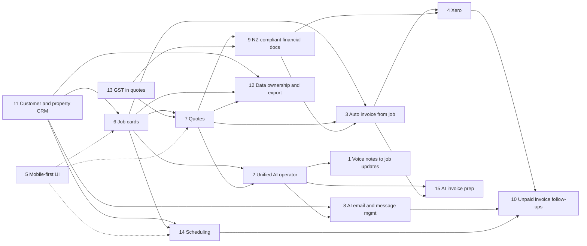

# Feature dependency map

The fifteen product features, what each needs first, and how four reference workflows traverse the modules in [architecture-v2.md](architecture-v2.md). Baseline status was derived from the code at commit `8c2f736` (2026-10-19). Machine-readable version: [features.json](features.json). The lead updates statuses as phases land; this page records the baseline.

Status vocabulary for features: **Already working**, **Partially implemented**, **Stubbed**, **Not started**, **Deferred**. "Working" here means exercised by automated tests, not by a real external system.

## Features

| ID  | Feature                          | Phase          | Baseline status       | Baseline evidence                                                                                                                                                                                                                       |
| --- | -------------------------------- | -------------- | --------------------- | --------------------------------------------------------------------------------------------------------------------------------------------------------------------------------------------------------------------------------------- |
| 1   | Voice notes to job updates       | 4              | Not started           | No audio, speech or transcript code; `SpeechToText` not defined                                                                                                                                                                         |
| 2   | Unified AI operator              | 4              | Partially implemented | Enquiry interpretation via `AgentRuntime` with mock tested (`tests/integration/vertical-slice.test.ts`, `packages/agent/src/agent.test.ts`); real adapter never run against a live Gateway; no tools                                    |
| 3   | Auto invoice from job            | 3              | Not started           | No invoice tables or code                                                                                                                                                                                                               |
| 4   | Xero                             | 3              | Stubbed               | `provider_connections` allows provider `xero`; no code uses the table; no adapter                                                                                                                                                       |
| 5   | Mobile-first UI                  | 1 (continuous) | Partially implemented | PWA with manifest, service worker, viewport meta (`apps/web`); no phone-width audit or e2e on a phone viewport; **unverified**                                                                                                          |
| 6   | Job cards                        | 1              | Partially implemented | `jobs`, `job_notes`, status, search (`tests/integration/records.test.ts`); no timeline, evidence or properties                                                                                                                          |
| 7   | Quotes                           | 2              | Partially implemented | Deterministic draft, owner approve/reject, stale-version refusal, idempotent approval, JSON document (`tests/integration/vertical-slice.test.ts`); integer quantity only; no PDF, send, acceptance, expiry or versions beyond a counter |
| 8   | AI email and message management  | 5              | Stubbed               | `communications` table (channels include `email`, `whatsapp`), relay inbox and HMAC ingress tested (`tests/integration/queue-and-relay.test.ts`); no mail or messaging adapter, no drafting                                             |
| 9   | NZ-compliant financial documents | 3              | Not started           | Tax label and rate exist on `businesses`; no GST number, tax-invoice layout or PDF                                                                                                                                                      |
| 10  | Unpaid invoice follow-ups        | 6              | Not started           | Queue exists; no invoices, payments or reminders                                                                                                                                                                                        |
| 11  | Customer and property CRM        | 1              | Partially implemented | `customers`, `customer_contacts`, search, archive (`tests/integration/records.test.ts`); address is free text, no properties                                                                                                            |
| 12  | Data ownership and export        | 1, 7           | Partially implemented | Encrypted logical backup and restore round trip (`tests/integration/backup.test.ts`), portability docs; no per-customer or full export, no restic scripts                                                                               |
| 13  | GST in quotes                    | 2              | Partially implemented | Business-level rate in basis points, tax rounded half-up once on the subtotal, shown as an assumption (`packages/core/src/quote.test.ts`); no per-line tax treatment, no zero-rated or exempt, no GST-inclusive entry                   |
| 14  | Scheduling                       | 6              | Partially implemented | Appointments, availability (DST-aware), conflict checks, reminder drafts on the queue, calendar UI (ADR 0019); no ICS export, calendar sync or reminder sending                                                                         |
| 15  | AI invoice preparation           | 4              | Not started           | Depends on invoices and tool gateway                                                                                                                                                                                                    |

## Dependency graph

An arrow `A --> B` means B depends on A.

Dotted lines mean "constrains the design of", not a build dependency.

## Prerequisites per feature

| ID  | Needs first | Technical prerequisites                                                                     | External blockers                                                        |
| --- | ----------- | ------------------------------------------------------------------------------------------- | ------------------------------------------------------------------------ |
| 11  | none        | Migration 0004 (`properties`)                                                               | none                                                                     |
| 6   | 11          | 0004 (`job_events`, `job_evidence`); file store (exists)                                    | none                                                                     |
| 5   | none        | Phone-width review of every screen; Playwright mobile viewport project                      | none                                                                     |
| 13  | none        | Money v2 in `packages/core`; fractional quantity; tax treatment per line                    | Confirmation of NZ GST rules (IRD guidance not reachable during Phase 0) |
| 7   | 6, 13       | 0005; quote state machine; acceptance tokens; react-pdf                                     | none                                                                     |
| 9   | 7, 13       | Business tax profile (0006); tax-invoice template                                           | IRD requirements confirmed                                               |
| 3   | 6, 7, 9     | 0006 (`invoices`, lines, numbering); invoice PDF                                            | none                                                                     |
| 4   | 3, 9        | Outbox (0006); `AccountingAdapter`; credential encryption applied to `provider_connections` | Xero app registration, sandbox (demo company) credentials, API tier cost |
| 2   | 6, 7        | Tool gateway (MCP in API); 0007; ADR for tool exposure                                      | Live OpenClaw Gateway to prove MCP auth and tool policy                  |
| 1   | 2, 6        | `SpeechToText` adapter; 0007 (`voice_notes`, `transcripts`); audio conversion to WAV        | whisper.cpp binary and model files on the host                           |
| 15  | 2, 3        | `invoice.prepare` tool; action proposals                                                    | as for 2                                                                 |
| 8   | 11, 2       | 0008; `MailProvider`; communications gateway pipeline                                       | Mail provider OAuth app (Gmail or Microsoft Graph) and test mailbox      |
| 14  | 6, 11       | 0009; `appointments`; FullCalendar in PWA; optional ICS export                              | none for ICS; calendar OAuth apps later                                  |
| 10  | 4, 8, 14    | Payment snapshots; reminders; draft-only follow-up messages                                 | Xero (for real payment state), messaging provider                        |
| 12  | 11, 6, 7    | Export job on the queue (0004); restic scripts (Phase 7)                                    | none                                                                     |

## Reference workflows

The four workflows are this document's reading of the brief's reference scenarios; adjust if the owner defines them differently. Each step names the module from [architecture-v2.md](architecture-v2.md) and whether it exists.

### Workflow A: enquiry to accepted quote

| Step                                                       | Module                                            | Status                                         |
| ---------------------------------------------------------- | ------------------------------------------------- | ---------------------------------------------- |
| Owner or agent receives an enquiry                         | 9 Operator, 7 Communications (manual entry today) | Exists (manual; `POST /api/enquiries`)         |
| Match customer and property; create job                    | 2 Customers and properties, 3 Jobs                | Customer match and job exist; property planned |
| Backend prices a draft from approved rates                 | 4 Pricing and quotes                              | Exists (integer quantity)                      |
| Owner approves                                             | 4 Quotes, 1 Identity                              | Exists                                         |
| Quote PDF generated, sent, customer accepts via token link | 4 Quotes, 10 Documents, 7 Communications          | Planned (Phase 2, send in Phase 5)             |

### Workflow B: job completion to paid invoice

| Step                                                                                    | Module                         | Status                          |
| --------------------------------------------------------------------------------------- | ------------------------------ | ------------------------------- |
| Owner marks job complete; evidence attached                                             | 3 Jobs                         | Status exists; evidence planned |
| Invoice prepared from the accepted quote and job notes (agent proposes, backend builds) | 5 Invoicing, 9 Operator        | Planned (Phases 3, 4)           |
| Owner approves and issues; tax-invoice PDF                                              | 5 Invoicing, 10 Documents      | Planned (Phase 3)               |
| Outbox pushes to Xero; payment state pulled back                                        | 6 Accounting, queue and outbox | Planned (Phase 3)               |
| Unpaid after due date: follow-up draft for owner approval                               | 5, 7, 8                        | Planned (Phase 6)               |

### Workflow C: voice note on site to job update

| Step                                                     | Module                    | Status            |
| -------------------------------------------------------- | ------------------------- | ----------------- |
| Owner records audio in the PWA                           | PWA                       | Planned (Phase 4) |
| Audio stored; transcription task queued                  | 10 Documents, queue       | Planned           |
| `SpeechToText` returns a transcript (revision 1)         | 9 Operator                | Planned           |
| Agent proposes notes, status change, materials via tools | 9 Operator (tool gateway) | Planned           |
| Owner confirms proposals; job timeline updated           | 3 Jobs                    | Planned           |

### Workflow D: inbound customer message to approved reply and appointment

| Step                                                   | Module                           | Status                                                              |
| ------------------------------------------------------ | -------------------------------- | ------------------------------------------------------------------- |
| Email or message arrives, normalised and de-duplicated | 7 Communications, `relay_inbox`  | Relay harness exists; mail and messaging adapters planned (Phase 5) |
| Linked to customer and job                             | 2, 3, 7                          | Planned                                                             |
| Agent drafts a reply (`communication.draft`)           | 9 Operator                       | Planned                                                             |
| Owner edits and approves; backend sends                | 7 Communications, `MailProvider` | Planned                                                             |
| Appointment proposed, confirmed, reminder scheduled    | 8 Scheduling                     | Implemented and tested (reminder is prepared as a draft, not sent)  |
